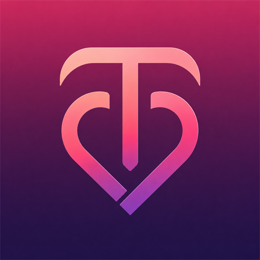
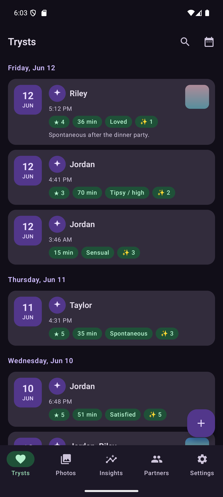
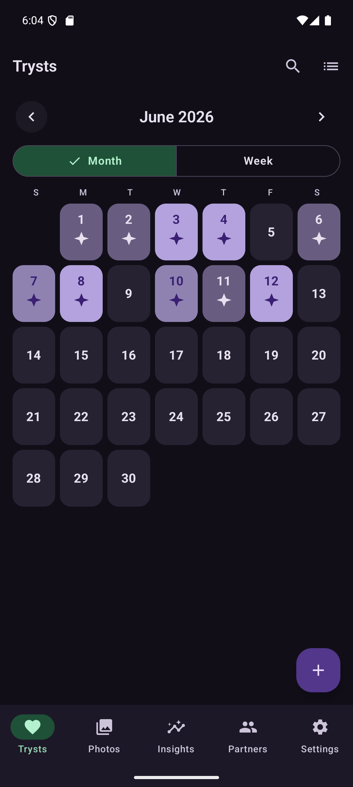
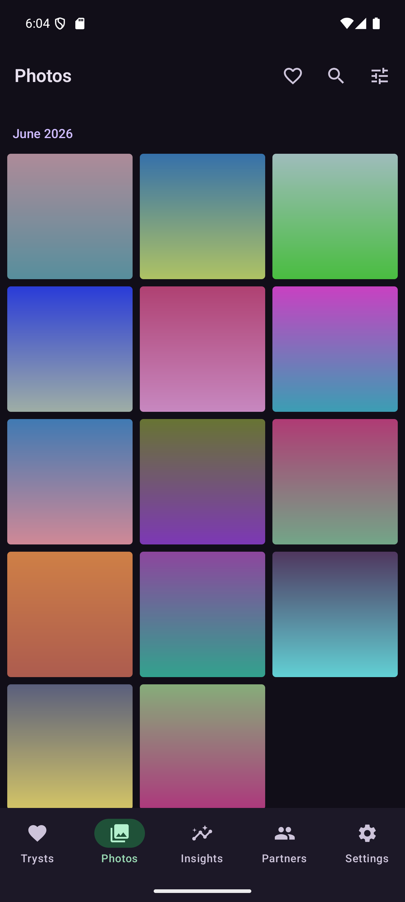
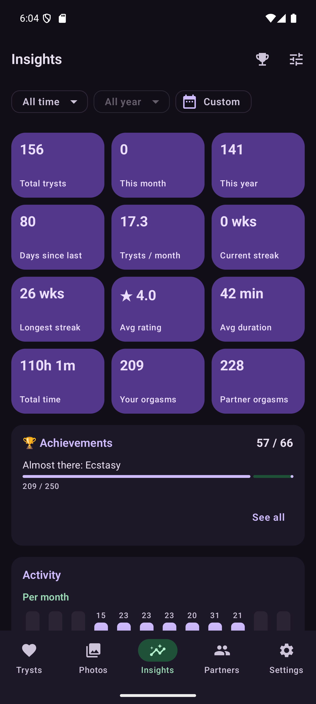
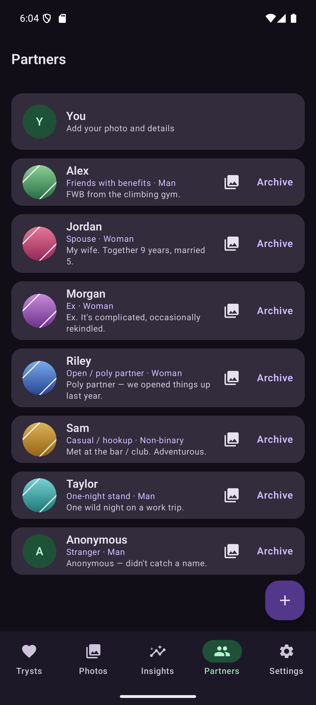

<div align="center">

<h1><br /></h1>

### A private, local-only journal for your intimate life — encrypted, offline, and open source.

[](LICENSE)
[](https://f-droid.org/en/packages/app.tryst/)
[](#built-with)
[](#built-with)
[](#built-with)
[](#why-tryst)
[](CHANGELOG.md)

Tryst keeps your most personal data on your phone and nowhere else — no account, no sync,
and **no internet permission at all**, so the app *cannot* send your data anywhere.
Inspired by other tracking apps you need to pay for, and built so privacy is the feature, not a footnote.

<a href="https://f-droid.org/packages/app.tryst/"></a>

<a href="fastlane/metadata/android/en-US/images/phoneScreenshots/01_trysts_list.png"></a>
<a href="fastlane/metadata/android/en-US/images/phoneScreenshots/02_trysts_calendar.png"></a>
<a href="fastlane/metadata/android/en-US/images/phoneScreenshots/03_photos_grid.png"></a>
<a href="fastlane/metadata/android/en-US/images/phoneScreenshots/05_insights.png"></a>
<a href="fastlane/metadata/android/en-US/images/phoneScreenshots/06_partners.png"></a>

<sub><i>Screenshots captured from a recent build on a synthetic dataset (no real data).</i></sub>

</div>

## Why Tryst

Privacy isn't a setting here — it's the architecture.

- 🚫 **No network, ever.** The app declares no `INTERNET` permission, and a build-time CI guard
  fails the build if one ever sneaks in. Data physically cannot leak to a server.
- 🔒 **Encrypted at rest.** Entries live in an encrypted **SQLCipher** database; photos are
  **Tink AES-256-GCM** blobs in the app's private storage — never your gallery, MediaStore, or any cloud.
- 🔑 **Locked to you.** A 6-digit app PIN (separate from your phone's), optional biometric unlock,
  auto-lock the moment Tryst leaves the screen, and `FLAG_SECURE` to blank screenshots and the
  app-switcher preview. The key is derived from your PIN and double-wrapped by a hardware-backed
  Keystore key (StrongBox when available).
- 📵 **Zero tracking.** No analytics, ads, or crash-reporting SDKs of any kind — none are in the build.
- 📤 **Your data is yours.** The only way it leaves the device is a manual, password-encrypted
  backup you control. There is no password recovery, because there is no server.
- 🔍 **Verifiable.** GPLv3 and fully open source, so every promise above is auditable — and F-Droid
  builds it from this source.

## Features

- **Rich encounter logging** — date, time, duration, partners, acts, positions, protection, mood,
  place, occasion, toys, kinks, a 1–5 rating, orgasms, notes, and encrypted photo attachments.
- **Every category is yours** — Tryst ships **no predefined catalogs**; the handful of neutral starter
  entries (Kissing, Date night, …) are just editable rows, and you **add, rename, or remove your own**
  acts, kinks, positions, toys, occasions, and finish locations on a dedicated management page per
  category. Everything you add — or had already logged — counts fully across Insights and Achievements.
- **Partners & a self profile** — named or anonymous partners with relationship type and optional
  demographics (age, ethnicity, height, body type, orientation from labels you write yourself, location) and a **portrait album per person** (a set
  of photos you can rotate the current avatar from), plus your own profile.
- **Photos gallery** — a browsable Photos tab over every image attached to a tryst plus every person's
  portrait album, with layouts (date grid, mosaic, by-partner, People avatars, feed), search, filters,
  favourites, bulk actions, a slideshow, and a full-screen viewer you swipe through, pinch to zoom, swipe down to
  close, and delete from (with undo). Select photos by long-pressing and dragging across a run, group the grid by day, month or year by pinching, and jump around a
  long timeline with the fast scroller and its month bubble. One tap in the viewer also files a photo
  under any partner (or You).
- **Insights** — a pure-Kotlin stats engine: totals, week streaks, averages, monthly & weekday
  trends, and per-attribute breakdowns. Reorder/hide tiles and cards, pick a chart style per card
  (bars / line / donut), with stable per-type colors. Charts are **hand-drawn** — no chart dependency.
- **Achievements** — dozens of milestones, streaks, and variety badges, derived from your log with
  progress bars and unlock dates. A Completionist badge rewards unlocking all the rest. No extra storage.
- **Calendar** — a tonal activity heatmap with per-day markers, month/week toggle, and swipe to
  page. Land on it by default if you like.
- **Backup & import** — full-fidelity password-encrypted export/restore (photos included), plus a
  CSV importer with column mapping to bring history in from other apps.
- **Thoughtful polish** — light/dark themes + Material You, tablet/foldable adaptive layouts, a
  discard-changes guard so a stray tap never eats a half-finished entry, a type-to-confirm reset,
  and an in-app *What's new*.

## Built with

Kotlin · Jetpack Compose + Material 3 · Room over **SQLCipher** · Google **Tink** (media crypto) ·
Hilt · Coroutines/Flow. `minSdk 31` (Android 12) · `compileSdk`/`targetSdk 36`. **No networking
libraries at all**, and charts are hand-drawn in Compose — the dependency surface stays tiny and
fully FOSS. Architecture is MVVM + repository with a package-by-feature layout; the stats and
achievements engines are stateless and JVM-unit-tested. See
[docs/ARCHITECTURE.md](docs/ARCHITECTURE.md) and [docs/FLOWCHARTS.md](docs/FLOWCHARTS.md).

## Install

Tryst is distributed through **F-Droid**, which builds and signs it from this source:

**[Get Tryst on F-Droid](https://f-droid.org/packages/app.tryst/)** (Android 12 or newer).

There is no APK attached to GitHub releases and no signing key in this repo. To run your own build,
see [Building](#building) below. F-Droid builds each tagged release, so a new version can take a
little while to appear there after it is tagged here.

## Building

Full toolchain notes are in [docs/SETUP_WINDOWS.md](docs/SETUP_WINDOWS.md). The essentials:

```powershell
$env:JAVA_HOME="C:\Program Files\Android\Android Studio\jbr"
.\gradlew.bat assembleDebug            # build the debug APK
.\gradlew.bat checkNoNetworkDebug      # anti-leak guard: fails if any network permission appears
.\gradlew.bat testDebugUnitTest        # JVM unit tests
.\gradlew.bat detekt ktlintCheck       # quality gates
```

Screenshots are black by design on-device (`FLAG_SECURE`).

## Status

✅ **Shipped.** Current release **v0.6.4** (versionCode 20, schema v19). Distribution is **F-Droid**,
which builds and signs from this source. Tryst ships no binary and commits no signing key.

- **0.6.4** keeps the details of every photo you import: when it was taken, the file name, camera, lens
  and GPS location, shown in the viewer's details sheet with Copy and Open in Maps. Imports use the system file
  picker, so Tryst still asks for no permissions. Photos in a person's album can now be favourited and captioned,
  back from a photo returns to the grid, and swiping up opens the details.
- **0.6.3** is a polish pass. Deleting photos now has a six-second Undo instead of a confirm dialog, the Photos
  grid can group by day, month or year (keep pinching past the tile limits), double-tap zoom animates, and
  photos open faster. Long-press any icon button for a tooltip, the launcher icon supports themed (monochrome)
  icons, and a new Completionist achievement rewards unlocking all the others.
- **0.6.2** adds an optional **orientation** field on your profile and partners, picked from labels you write
  yourself (nothing is preset). It is the first schema bump since 0.5.3 (v17), additive only.
- **0.6.1** is a photo pass. Swiping between photos in the viewer works again, and you can now delete
  from the viewer, swipe down to close it, drag across photos to select a run, and jump through a long
  timeline with a fast scroller.
- **0.6.0** made **settings survive a backup**: theme, Insights layout, and Photos layout preferences
  ride the encrypted export (container format v2, backward-compatible with v1 backups) instead of
  resetting on a new phone. It also brought a color refresh tied to the launcher icon and a pass of
  button and layout polish.
- **0.5.x** delivered the **Photos** tab (a gallery over every tryst photo and every person's portrait
  album, with search, filters, favourites and a slideshow), a full-screen partner editor, atomic
  encrypted-backup restore, inline add for every catalog category, and the fixes from a formal 7-lens
  post-release audit ([docs/audits/2026-07-30-triage.md](docs/audits/2026-07-30-triage.md)).

Everything you had already logged is preserved across every schema bump (v13→v14→v15→v16→v17, all
additive-only).

Full release notes are in [CHANGELOG.md](CHANGELOG.md); the milestone history and pre-release audit
program live in [docs/ROADMAP.md](docs/ROADMAP.md), and post-1.0 plans in
[docs/ROADMAP_FUTURE.md](docs/ROADMAP_FUTURE.md).

## Documentation

| Doc | What |
|-----|------|
| [REQUIREMENTS.md](docs/REQUIREMENTS.md) | Functional & non-functional requirements |
| [THREAT_MODEL.md](docs/THREAT_MODEL.md) | Adversaries, mitigations, residual risk |
| [SECURITY_DESIGN.md](docs/SECURITY_DESIGN.md) | Encryption & key management |
| [DATA_MODEL.md](docs/DATA_MODEL.md) | Entities & fields (schema v19) |
| [ARCHITECTURE.md](docs/ARCHITECTURE.md) | Stack & module layout |
| [FLOWCHARTS.md](docs/FLOWCHARTS.md) | Visual maps of the core logic flows |
| [ROADMAP.md](docs/ROADMAP.md) | Milestones & the 12-pass pre-release audit |
| [ROADMAP_FUTURE.md](docs/ROADMAP_FUTURE.md) | Post-1.0 roadmap (shipped + planned) |
| [ROADMAP_VIDEO.md](docs/ROADMAP_VIDEO.md) | Video attachments — its own theme (needs a runtime dep) |
| [DECISIONS.md](docs/DECISIONS.md) | Decision log & open questions |
| [RELEASE.md](docs/RELEASE.md) | Cut-a-release checklist + F-Droid submission |
| [CHANGELOG.md](CHANGELOG.md) | Per-release notes |
| [SETUP_WINDOWS.md](docs/SETUP_WINDOWS.md) | Build & run on Windows |

## License

**GPLv3.** Tryst is free, open-source software under the
[GNU General Public License v3.0](LICENSE) — so anyone can verify the privacy promises above, and any
redistributed version must also be GPLv3 with source available. Third-party components and their
licenses are listed in [THIRD_PARTY_NOTICES.md](THIRD_PARTY_NOTICES.md) and in-app under
**Settings → About** (all GPLv3-compatible).
